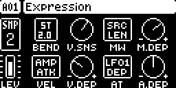
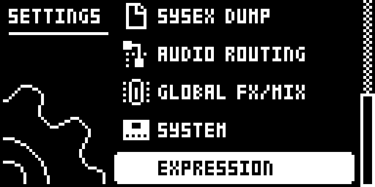
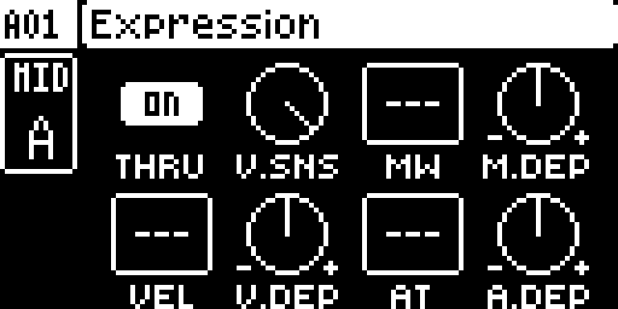
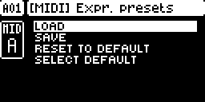
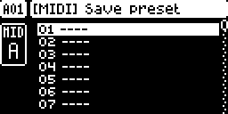
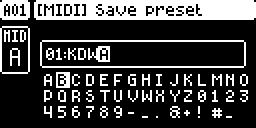

# Digi Expression for the Digitakt

**Mod for the original Digitakt (mk1, OS 1.54) to add support for pitch-bend, modwheel, aftertouch and breath controller messages.**

A module for [Modwerk](https://modwerk.app/),\
version 0.13.0-experimental.

> [!NOTE]
> **Work in progress.** An independent, experimental module written with the Modwerk SDK. Submitted to Modwerk for review; not in the Modwerk library yet, so Modwerk does not support it. Feedback and bug reports are welcome in [Issues](../../issues).

> [!WARNING]
> **Use at your own risk.** This modifies your Digitakt's firmware. It is provided as is, without warranty: the author is not responsible for lost data or a damaged instrument. Back up your projects and samples first, and keep the stock OS 1.54 file to go back.



On stock version the Digitakt passes an external keyboard's notes and velocity through to its tracks but drops pitch bend, mod wheel and aftertouch. With Digi Expression:

- **Audio tracks 1–8** parameters can be modulated with PB/MW/AT/VEL.
- **MIDI tracks A–H** pass-through of PB/MW/AT/BC to MIDI output, modulation destinations for MW/AT/VEL.
- **Velocity sensitivity** adjustment per track for all tracks.
- **Saved with the project**, back at power-on.
- **Presets** for your favourite routings.

Modwerk is an independent project, not affiliated with or endorsed by Elektron. This repository contains no Elektron firmware: everyone builds from their own official OS download.

## Known limits

**Other mods.** It links with every other Modwerk Digitakt module, Digi Perform included. With **Digi Slicer** it works, but only about 1.1 KB of RAM is left with both, so no third mod of any size fits beside them.

The others were linked with it one at a time ([results/compat/pairs.txt](results/compat/pairs.txt)); RAM decides which combinations of three or more fit. FX Track sees its CCs, and CC Recall's sends and Digi Matrix's routings add up with it.

**Other limits.**

* Original Digitakt (mk1) with OS 1.54 only.
* Live only: the sequencer never records the added expressions.
* Settings belong to the project's slot and the track's place (1–8, A–H): copying a sound or a track does not copy them; a preset carries them.
* A project put into a slot from outside (with Transfer) takes that slot's old settings file, if one is left.
* Writing a settings file holds the screen and the MIDI output for a moment (about 0.1 s in the emulator), so the power-on file is written only while the sequencer is stopped and nothing has been played for 2 seconds.
* The track's PB, AT and MW knobs on screen show the track's own value, not the sum.

## How to use it

### Open the page

Press **SETTINGS**, go down to **EXPRESSION** (below SYSTEM) and press **YES**: the EXPRESSION page of the active track. **TRK + trig** picks another track with the page up, and the page follows it. **NO** goes back to SETTINGS; a page key such as TRIG or FLTR closes it and does its stock job.

**Nothing is switched on at first.** Every track starts with THRU OFF, BEND OFF and no routes, so a fresh install plays exactly as stock. Switch on what you want per track, then save it as a preset and make that your default with SELECT DEFAULT, so new projects start that way.

| SETTINGS… | …EXPRESSION, YES |
| --- | --- |
|  |  |

### The knobs

| Knob | Audio track | MIDI track | Default |
| --- | --- | --- | --- |
| A | **BEND**: how far pitch bend moves TUNE, OFF to 12.00 semitones in fine steps | **THRU**: pitch bend, aftertouch, mod wheel and breath pass to the synth (ON/OFF) | OFF / OFF |
| B | **V.SNS**: velocity sensitivity, 0–100 % | **V.SNS** | 100 % |
| C, D | **MW** and its depth **M.DEP** | **MW** and **M.DEP** | none, 0 |
| E, F | **VEL** and **V.DEP** | **VEL** and **V.DEP** | none, 0 |
| G, H | **AT** and **A.DEP** | **AT** and **A.DEP** | none, 0 |

Turning a destination knob opens a list like the LFO page's DEST; push the same knob (or wait) to close it. Depths run from −64.00 to +64.00, as finely as the LFO's depth. **FUNC + turn** jumps between useful values: depths in steps of 16, BEND to whole semitones (OFF, 1, 2 … 12), V.SNS in quarters, destinations a page at a time. BEND turns as finely as a depth (2.50 semitones; its box shows 2.5).

### Destinations

Every destination adds to the track's own value (its knob, parameter locks and LFO) within the parameter's range; a depth of ±64 at a full source covers the whole range, as the stock LFO does.

<table>
<tr>
<td width="50%" valign="top">
<b>Audio track mod destinations</b><br>
<br>
<small>
<ins>Source</ins><br>
Tune<br>
Bit reduction<br>
Start<br>
Length<br>
Sample level<br>
<br>
<ins>Filter</ins><br>
Frequency<br>
Resonance<br>
Env. depth<br>
Attack time<br>
Decay time<br>
Sustain level<br>
Release time<br>
Base<br>
Width<br>
Env. delay<br>
Sample-rate redux<br>
<br>
<ins>Amp</ins><br>
Attack time<br>
Hold time<br>
Decay time<br>
Overdrive<br>
Delay send<br>
Reverb send<br>
Pan<br>
Volume<br>
<br>
<ins>LFO 1 + 2</ins><br>
Speed<br>
Multiplier<br>
Fade in/out<br>
Start phase<br>
Depth
</small>
</td>
<td width="50%" valign="top">
<b>MIDI track mod destinations</b><br>
<br>
<small>
<ins>Source</ins><br>
Pitch bend<br>
Aftertouch<br>
Mod wheel<br>
Breath controller<br>
<br>
<ins>CC</ins><br>
CC1 Val<br>
CC2 Val<br>
CC3 Val<br>
CC4 Val<br>
CC5 Val<br>
CC6 Val<br>
CC7 Val<br>
CC8 Val<br>
<br>
<ins>LFO</ins><br>
Speed<br>
Multiplier<br>
Fade in/out<br>
Start phase<br>
Depth
</small><br><br>
</td>
</tr>
</table>

## Presets

Presets keep one track's EXPRESSION settings, so a favourite routing can go on any track or project.

**The menu.** Hold **knob A pushed for a second** on the EXPRESSION page. The title says which kind of track it is for, `[SND]` (audio tracks) or `[MIDI]`. Move with UP/DOWN or the LEVEL knob, choose with YES (or a push of a knob), go back with NO, as in the stock menus; any page or menu key (SRC, FLTR, AMP, LFO, SETTINGS…) leaves it.

| The menu | SAVE: a slot… | …and a name |
| --- | --- | --- |
|  |  |  |

| Item | What it does |
| --- | --- |
| LOAD | lists the 64 presets of this kind of track; YES puts the chosen one on the current track |
| SAVE | pick one of the 64 slots, then name it as SAVE PROJECT AS names a project: UP/DOWN change the letter, LEFT/RIGHT move, hold FUNC for the letter grid (FUNC + arrows pick, letting go writes the letter and moves on, so FUNC, pick, let go types a name letter by letter), FUNC + YES inserts, FUNC + NO deletes, YES saves (asking first over a used slot), NO aborts |
| RESET TO DEFAULT | puts the current track back to the default preset (asks first) |
| SELECT DEFAULT | picks the preset that new projects and RESET TO DEFAULT start from: FACTORY (the mod's own defaults) or one of yours, marked `*` |

**Separate sets.** There are 64 presets for audio tracks and 64 for MIDI tracks; an audio preset cannot go on a MIDI track, or the other way round.

**Copied, never linked.** Loading a preset copies its settings into the track. Changing or overwriting the preset later does not change a project that used it; the project keeps its own copy.

**Where they are.** On the +Drive, as plain text files, next to the project settings:

| File | What |
| --- | --- |
| `/cfw/expression/audio/01.txt` … `64.txt` | the audio-track presets, the slot in the file name and the preset's name inside |
| `/cfw/expression/midi/01.txt` … `64.txt` | the MIDI-track presets |
| `/cfw/expression/config.txt` | which preset is the default for each kind of track |
| `/cfw/expression/projects/003.txt` | project slot 003's settings for all 16 tracks |
| `/cfw/expression/current.txt` | the settings as they are now, for power-on |
| `/cfw/expression/_temp/…` | a safety copy of each: every file is written there first |

A preset file reads like this, and can be edited by hand: a value out of range is held to the nearest valid one, an unknown line is skipped, a missing value is the factory default, and a file without its first line or its `END` line is not used (its `_temp` copy is, or the defaults).

```
MIDI EXPRESSION PRESET AUDIO 1
NAME=Lead
BEND=5.00   ; semitones
V.SNS=100   ; %
MW=26   ; FLTR:Frequency
M.DEP=+32.00
VEL=45   ; AMP:Volume
V.DEP=+24.00
AT=0   ; None
A.DEP=+0.00
END
```

To share a preset, copy its file to another Digitakt's `/cfw/expression/audio/` or `midi/` under a free number. (Whether Elektron Transfer can fetch and send these text files is not checked yet: the original Digitakt does not appear as a USB drive.)

## How it works

Digi Expression is an elemod for Modwerk's Core 2.1: small, checksummed patches ("sites") at known places in OS 1.54, each claimed so that no two mods patch the same instruction.

- **Input.** The firmware hands each incoming MIDI message to a handler chosen by its type. Stock's pitch bend and aftertouch handlers do nothing; the mod points them at its own, and wraps the control-change handler (the stock one always runs first). Each message follows the route the notes take: the AUTO CHANNEL to the active track, a TRACK CHANNEL to its track.
- **MIDI tracks.** The track's own values (knob, locks, LFO) pass through the firmware's `send()`; the mod sees each one there. While anything live is aimed at a value, the mod sends the sum instead (capped to the MIDI range), so the synth never gets two competing values. Values on the same CC number (the mod wheel and a CC VAL slot on SEL 1, say) are merged into one. Everything is sent by the MIDI tracks' own task in its normal output pass, after the sequencer's notes and in their buffers, so the mod never touches the MIDI drivers.
- **Audio tracks.** Two hooks in the audio render add the live values to the sound's parameter words after the firmware has built them, one before the LFO stage (for the LFO amounts) and one after it. Nothing is written into the sound, so it stops the moment the input does.
- **MIDI tracks' LFO.** A hook around the LFO's calculation adds the live routes to its speed, multiplier, fade, start phase and depth for that moment only, and puts the track's own values back.
- **Velocity.** Once the firmware has stored a played note's velocity, a hook applies V.SNS to what plays; another hook at the MIDI tracks' note output does the same for MIDI notes. The sequencer still records the velocity as played.
- **The page** is drawn with the firmware's own knob graphics, fonts and acceleration through the core's draw, key, encoder and tick events.
- **Saving.** No byte of a saved sound or pattern is free (other mods use the few there are), so the settings are text files of the mod's own on the +Drive, in `/cfw/expression`: one per project slot (`projects/003.txt`, the project's name inside), one per preset (`audio/01.txt`, `midi/01.txt`), a `config.txt` and a `current.txt` for power-on. Hooks on the firmware's project save, load and CREATE NEW (which applies the default presets) tell the mod the project's slot, so renaming a project or deleting another one changes nothing. Every file is written to `_temp` first and then in its place, and must end with an `END` line: a file cut short by a power cut, or broken, is skipped for its copy, then for the defaults. Hand-edited values out of range are held to the nearest valid one.

The research behind every address is in [docs/RESEARCH-OS154.md](docs/RESEARCH-OS154.md); the module's own documentation is [module/midi-expression/README.md](module/midi-expression/README.md).

## Status and tests

Experimental. Tested with about 2.4 million host unit checks (including thousands of random broken files), on the firmware in the [digiemu](https://github.com/irpina/digiemu) emulator (MIDI-track sums and merging, saving and loading through the firmware's own menus, the preset menu, memory and CPU use), and on the author's own Digitakt (mk1, OS 1.54) with 0.12.4.

**On the hardware** ([docs/HARDWARE-TESTS.md](docs/HARDWARE-TESTS.md), November 2026): all eight MIDI tracks set up to test a different part of the mod and checked value by value against a model, over DIN and USB at once, both outputs carrying exactly the same messages: pass-through, routes to CC VALs, pitch bend, aftertouch and the mod wheel, merging, THRU OFF, V.SNS and velocity routes, 3,000 random messages, the sequencer started over MIDI, live input with external clock running, a 20-second flood of 15,511 messages with the sequencer playing; saving, loading, power cycles and CREATE NEW with the default presets; the page and the preset menu by eye. Round trip: 0.9 ms USB to USB, 2.9 ms DIN to DIN through the interface.

**Resources** (emulator): no memory is allocated, and hundreds of file writes and reads leave the firmware's heap exactly as it was. CPU in the module area: about 1.2 % of the emulated CPU idle and 1.8 % with every route of every track live under a flood of MIDI at the wire rate (the emulator counts 64 million instructions a second; the unit's CPU is faster). RAM: in an image of its own, 93 KB of the module area stay free; 1.0 KB beside Digi Slicer.

## Build it

Flashing modified firmware is at your own risk (see the warning at the top). A failed flash is recovered by holding FUNC at power-on, choosing OS UPGRADE and sending the stock OS.

You need your own copy of the official OS 1.54 file, Modwerk and its m68k toolchain; see [BUILDING.md](BUILDING.md).

```sh
source env.sh
scripts/build-mod.sh "$PWD/build/midi-expression.syx"
```

The image is built from your OS file and stays on your computer. Send it with Elektron Transfer. To go back, hold FUNC at power-on, choose OS UPGRADE and send the stock OS.

### Hardware tests

`scripts/hwqual.py` tests a unit over DIN and USB: set up the test project as [docs/TEST-SETUP.md](docs/TEST-SETUP.md) describes, then follow [docs/HARDWARE-TESTS.md](docs/HARDWARE-TESTS.md). Check the MIDI interface and cables first (`scripts/loopback.py`, `scripts/hwcheck.py`).

## Licence

GPL-3.0-or-later. See [LICENSE](LICENSE).
