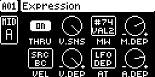
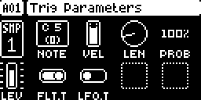
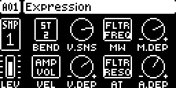
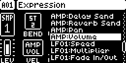
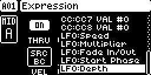

# MIDI Expression for the Digitakt

**Play the original Digitakt (mk1, OS 1.54) and the synths it sequences with pitch bend, aftertouch, the mod wheel, breath and velocity from your keyboard.** A [Modwerk](https://modwerk.app/) module, version 0.10.0-experimental.



Stock, the Digitakt passes an external keyboard's notes through to its tracks but drops pitch bend, aftertouch and the mod wheel. With MIDI Expression:

- **MIDI tracks A–H** pass pitch bend, aftertouch, the mod wheel (CC 1) and breath (CC 2) to the synth they play, **added to the track's own values**: its knob, parameter locks and LFO. Nothing jumps or fights.
- **Audio tracks 1–8** bend their pitch, and the wheel, aftertouch and velocity move any SRC, FLTR, AMP or LFO amount of the sound.
- **Every track has its own routings** on a new page, the TRIG page's second page: three sources (mod wheel, velocity, aftertouch), each to a destination of your choice with its own depth, plus velocity sensitivity.
- **Velocity sensitivity** per track, for live notes and the sequencer alike; the sequencer still records the velocity as played.
- **Saved with the project**, and back at power-on.

Modwerk is an independent project, not affiliated with or endorsed by Elektron. This repository contains no Elektron firmware: everyone builds from their own official OS download.

## How to use it

### Open the page

Select a track, press **TRIG** for its TRIG page, then **tap TRIG again**: the EXPRESSION page. TRIG or NO goes back; every other key keeps its stock job.

| The TRIG page… | …tap TRIG again |
| --- | --- |
|  |  |

### The knobs

| Knob | Audio track | MIDI track | Default |
| --- | --- | --- | --- |
| A | **BEND**: how many semitones pitch bend moves TUNE (OFF, 1–12) | **THRU**: pitch bend, aftertouch, mod wheel and breath pass to the synth (ON/OFF) | 2 / ON |
| B | **V.SNS**: velocity sensitivity, 0–100 % | **V.SNS** | 100 % |
| C, D | **MW** and its depth **M.DEP** | **MW** and **M.DEP** | none, 0 |
| E, F | **VEL** and **V.DEP** | **VEL** and **V.DEP** | none, 0 |
| G, H | **AT** and **A.DEP** | **AT** and **A.DEP** | none, 0 |

Turning a destination knob opens a list like the LFO page's DEST; push the same knob (or wait) to close it. Depths run from −64.00 to +64.00, as finely as the LFO's depth. **FUNC + turn** jumps between useful values: depths in steps of 16, BEND 1, 2, 3, 5, 7, 12, V.SNS in quarters, destinations a page at a time.

| Audio track destinations | MIDI track destinations |
| --- | --- |
|  |  |
| SRC, FLTR, AMP, LFO1 and LFO2 amounts: the wheel can open the filter, velocity can raise the volume, aftertouch can add vibrato through an LFO's depth. | The MIDI LFO page's values: pitch bend, aftertouch, mod wheel, breath and CC VAL 1–8 on the CC numbers their SEL picks (shown as `CC:CC2 VAL #74`), and the track's own LFO speed, multiplier, fade, phase and depth. |

### Quick tutorial: a synth with expression

1. Connect your keyboard to the Digitakt's MIDI IN, on its AUTO CHANNEL (SETTINGS > MIDI CONFIG > CHANNELS), and a synth to MIDI OUT. In PORT CONFIG, tick RECEIVE NOTES and RECEIVE CC/NRPN.
2. Select MIDI track A (TRK + trig 9), switch its CHAN on (SRC page, FUNC + knob A) and set it to the synth's channel.
3. Play: notes, pitch bend, aftertouch, the mod wheel and breath reach the synth.
4. For more: on the EXPRESSION page, route the wheel to a CC VAL slot (say the synth's filter, CC 74 on the AMP page's SEL) and velocity to its LFO depth.
5. For an audio track: select it, open its EXPRESSION page, set BEND and route the wheel to FLTR Frequency.
6. Save the project as usual: the EXPRESSION settings are saved with it.



## How it works

MIDI Expression is an elemod for Modwerk's Core 2.1: small, checksummed patches ("sites") at known places in OS 1.54, each claimed so that no two mods patch the same instruction.

- **Input.** The firmware hands each incoming MIDI message to a handler chosen by its type. Stock's pitch bend and aftertouch handlers do nothing; the mod points them at its own, and wraps the control-change handler (the stock one always runs first). Each message follows the route the notes take: the AUTO CHANNEL to the active track, a TRACK CHANNEL to its track.
- **MIDI tracks.** The track's own values (knob, locks, LFO) pass through the firmware's `send()`; the mod sees each one there. While anything live is aimed at a value, the mod sends the sum instead (capped to the MIDI range), so the synth never gets two competing values. Values on the same CC number (the mod wheel and a CC VAL slot on SEL 1, say) are merged into one. Everything is sent by the MIDI tracks' own task in its normal output pass, after the sequencer's notes and in their buffers, so the mod never touches the MIDI drivers.
- **Audio tracks.** Two hooks in the audio render add the live values to the sound's parameter words after the firmware has built them, one before the LFO stage (for the LFO amounts) and one after it. Nothing is written into the sound, so it stops the moment the input does.
- **Velocity.** A hook just after the render stores a note's velocity applies V.SNS to what plays; another at the MIDI tracks' note output does the same for MIDI notes. The sequencer records the velocity as played.
- **The page** is drawn with the firmware's own knob graphics, fonts and acceleration through the core's draw, key, encoder and tick events.
- **Saving.** No byte of a saved sound or pattern is free (other mods use the few there are), so the settings live in a small file of the mod's own on the +Drive, written with the firmware's own file calls in two alternating copies so that a power cut never loses both. Hooks on the project save and load messages tell it which project it is.

The research behind every address is in [docs/RESEARCH-OS154.md](docs/RESEARCH-OS154.md); the module's own documentation is [module/midi-expression/README.md](module/midi-expression/README.md).

## Compatibility

- Original Digitakt (mk1), OS 1.54 only.
- Links with every other Modwerk Digitakt module except **Digi Perform**, which opens its own page with the same TRIG gesture ([results/compat/pairs.txt](results/compat/pairs.txt)). With Digi Slicer, about 5 KB of RAM stay free.
- FX Track sees the mod's CCs; CC Recall's sends and Digi Matrix's routings add up with it.
- Avoid a MIDI loop: a synth that echoes MIDI OUT back into MIDI IN on the same channel feeds the mod's output back to it.
- Settings belong to the project's name and the track's place: copying a sound does not copy them, and two projects with the same name share them (32 projects are kept).

## Status and tests

Experimental. Tested with about 2.4 million host unit checks, on the firmware in the [digiemu](https://github.com/irpina/digiemu) emulator (MIDI-track sums and merging, saving and loading through the firmware's own menus), and on one unit: the audio-track features and a hardware stress test of the MIDI tracks, 25 of 25. Saving and the MIDI LFO destinations are not yet tested on a unit. Details: [module/midi-expression/TESTING.md](module/midi-expression/TESTING.md).

## Build it

You need your own copy of the official OS 1.54 file, Modwerk and its m68k toolchain; see [BUILDING.md](BUILDING.md).

```sh
source env.sh
scripts/build-mod.sh "$PWD/build/midi-expression.syx"
```

The image is built from your OS file and stays on your computer. Send it with Elektron Transfer. To go back, hold FUNC at power-on, choose OS UPGRADE and send the stock OS.

### Hardware stress test

`scripts/hwstress.py` plays expression, notes and floods into the Digitakt's MIDI IN, records everything from its MIDI OUT, and checks it. No synth is needed: the Digitakt's MIDI OUT goes back to the computer (Python 3 with `python-rtmidi`).

- **Cables:** interface MIDI OUT → Digitakt MIDI IN, Digitakt MIDI OUT → interface MIDI IN. Check the loop first: `scripts/hwping.py "<port>"` must print what came back.
- **Project (a scratch project):** SETTINGS > MIDI CONFIG > SYNC: CLOCK SEND on; PORT CONFIG: RECEIVE NOTES and RECEIVE CC/NRPN on. MIDI track A: CHAN 1; SRC PB 0, AT 0, MW 10, BC 0; FLTR VAL1 10, VAL2 0, VAL3 0; AMP SEL1 1, SEL2 74, SEL3 2; trigs on steps 1, 5, 9 and 13; LFO DEST none. Its EXPRESSION page at the defaults (THRU ON, V.SNS 100 %, no routes, depths 0).
- **Run:** `scripts/hwstress.py --in "<port>" --out "<port>"`, optionally `--only own,thru,release,routes,sens,seq,lfo,record` to leave out the flood. It asks for a few page changes on the way. Results go to `results/hardware/stress-<date>/`.

## Licence

GPL-3.0-or-later. See [LICENSE](LICENSE).
